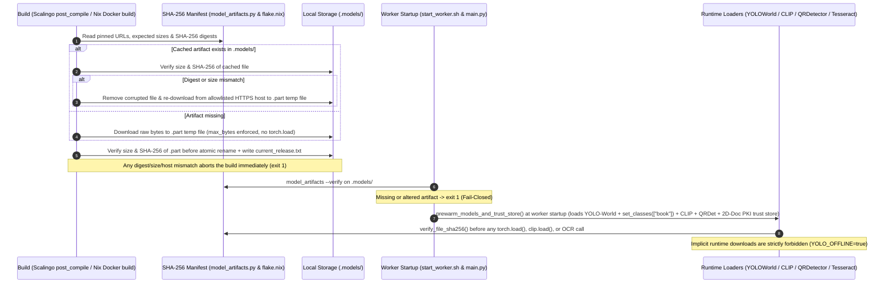

# Security Architecture: Verifiable Deployment Artifacts & Model Integrity

**Initiative**: #151 - Security Hardening
**Tracking Plan**: I1 (F6, F8) | **Priority**: P1
**Associated Design Decision**: D3 (Hosting, Operations & Cutover)
**GitHub Reference**: `Closes #166`

---

## 1. Executive Summary

Document IA processes sensitive user documents using Python dependencies, native system libraries (Tesseract OCR, libmagic, OpenCV, Zlib), and pre-trained AI/OCR model weights (`yolov8m-world.pt`, `ViT-B-32.pt`, `qrdet-s.pt`, `fra.traineddata`).

Prior to Issue #166:
- Model weights were downloaded during `post_compile` by instantiating `YOLOWorld()` and `QRDetector()` (which immediately executed `torch.load` / `pickle` without cryptographic digest verification) or via unverified `curl` calls against moving branches (`main`).
- Calling `YOLOWorld.set_classes()` at runtime triggered an implicit `clip.load("ViT-B/32")` download (~338 MiB `ViT-B-32.pt`) from `openaipublic.azureedge.net`.
- Cached weights in `.models/` were never re-verified across builds.
- Runtime model loading (`yoloworld_crop.py`, `extract_barcode_2ddoc_data.py`, `main.py`) did not verify SHA-256 digests before deserialization, allowed implicit runtime network downloads when files were missing, and logged a non-fatal warning in `_prewarm_models()` (*fail-open*).
- Container images and system packages were not locked by a reproducible cryptographic manifest.

This document specifies the architecture implemented for **I1 (#166)**:
1. **Cryptographic Pinning & Fail-Closed Runtime Verification (`model_artifacts.py`)**: All four AI/OCR artifacts are pinned to immutable upstream URLs, SHA-256 digests, and exact byte sizes, and verified at build time, container startup, and before any `torch.load`, `clip.load`, or Tesseract execution.
2. **Offline Execution Enforcement (`yoloworld_crop.py`)**: `YOLO_OFFLINE="true"` and `YOLO_CONFIG_DIR="/tmp/Ultralytics"` are enforced, `ultralytics` `WEIGHTS_DIR` is pointed at the verified `.models/` directory, and the active `set_classes()` state is cached under a reentrant lock so `clip.load` never triggers runtime network downloads.
3. **Unified Python Workspace Lock (`uv.lock`)**: All direct and transitive Python dependencies across the monorepo are locked in the root `uv.lock`, with `pyright` isolated to `dev` dependency groups and `uv run --no-project` enforced in `post_compile`.
4. **Hardened Multi-Stage Nix Container Artifacts (`flake.nix` + `flake.lock` + `Dockerfile`)**: System packages (`python314`, `tesseract`, `file`/`libmagic`, `glib`, `libGL`, `zlib`, `openssl`, `cacert`) and model derivations (`pkgs.fetchurl`) are locked in `flake.lock`. All 6 role-specific container images are built in multi-stage Dockerfiles (`nixos/nix:2.28.5` pinned by SHA-256 digest as `builder`, exporting only the strict `nix-store -qR /nix-env` runtime closure into `FROM scratch`) with zero build tools (`nix`, `uv`, `git`) at runtime and read-only `/app`, `.venv`, and `.models/` owned by `root:root` (`0:0`) for UID `10001:10001`.

---

## 2. Pinned AI & OCR Model Artifacts

All model artifacts are defined in [`document-ia-worker/src/document_ia_worker/core/model_artifacts.py`](../document-ia-worker/src/document_ia_worker/core/model_artifacts.py) and mirrored in [`flake.nix`](../flake.nix):

| Artifact Key | File Name | Relative Path in `.models/` | Immutable Source URL | SHA-256 Digest | Size (Bytes) |
| :--- | :--- | :--- | :--- | :--- | :--- |
| `yoloworld` | `yolov8m-world.pt` | `yolov8m-world.pt` | `https://github.com/ultralytics/assets/releases/download/v8.4.0/yolov8m-world.pt` | `8ede3cfa80c243608a9ef14d54f55030efc9d7a8635af245fc6d67efdf294aaa` | `58,610,242` |
| `clip` | `ViT-B-32.pt` | `clip/ViT-B-32.pt` | `https://openaipublic.azureedge.net/clip/models/40d365715913c9da98579312b702a82c18be219cc2a73407c4526f58eba950af/ViT-B-32.pt` | `40d365715913c9da98579312b702a82c18be219cc2a73407c4526f58eba950af` | `353,976,522` |
| `qrdet` | `qrdet-s.pt` | `qrdet/qrdet-s.pt` | `https://github.com/Eric-Canas/qrdet/releases/download/v2.0_release/qrdet-s.pt` | `50a9113970a878a51206d5caabcc2c758856f751944199a2c371d872fd768af1` | `23,970,659` |
| `tesseract_fra` | `fra.traineddata` | `tessdata/fra.traineddata` | `https://github.com/tesseract-ocr/tessdata_fast/raw/4.1.0/fra.traineddata` | `ced037562e8c80c13122dece28dd477d399af80911a28791a66a63ac1e3445ca` | `1,130,365` |

### Role of `ViT-B-32.pt` and Scalingo Slug Size Note
- **Why `ViT-B-32.pt` is pinned**: When `YOLOWorld.set_classes([class_name])` is called in `yoloworld_crop.py`, Ultralytics invokes `clip.load("ViT-B/32", download_root=str(WEIGHTS_DIR / "clip"))`. Pinning `ViT-B-32.pt` under `.models/clip/ViT-B-32.pt` and pointing Ultralytics `WEIGHTS_DIR` and `SETTINGS["weights_dir"]` to the verified `.models/` root guarantees zero implicit downloads at runtime.
- **Scalingo slug size impact**: `ViT-B-32.pt` adds ~338 MiB to `.models/` (bringing the 4 bundled model artifacts to ~418 MiB total). When deploying via the Scalingo Python buildpack, monitor compressed slug size limits if additional models or large dependencies are introduced.
- **QRDet release marker**: `qrdet/current_release.txt` is written and verified with exact content `https://github.com/Eric-Canas/qrdet/releases/download/v2.0_release` (without trailing newline) so `QRDetector` never attempts an outbound HTTP check at runtime.

---

## 3. Verification Lifecycle (Buildpack & Nix Container -> Runtime)



### Runtime Verification API

- `get_default_models_dir() -> Path`:
  Resolves `MODELS_DIR` from the environment with fallback to `DEFAULT_MODELS_DIR` (`document-ia-worker/.models`).
- `verify_file_sha256(path: Path, expected_sha256: str, artifact_name: str, expected_size_bytes: int | None = None) -> Path`:
  Validates file existence, regular file status, exact `expected_size_bytes` (when provided), and SHA-256 digest (wrapping any `OSError` into `ModelArtifactIntegrityError` so callers cannot fail open). Caches verified results in memory keyed by `(resolved_path, st_mtime_ns, st_size, expected_sha256)`.
- `resolve_and_verify_yoloworld_path(models_dir: Path | None = None) -> Path`:
  Called by `get_yoloworld_model()` in `yoloworld_crop.py` prior to `YOLOWorld(str(verified_path))`.
- `resolve_and_verify_clip_path(models_dir: Path | None = None) -> Path`:
  Supports `CLIP_WEIGHTS_PATH` and `MODELS_DIR`; called by `ensure_yoloworld_classes()` / `detect_boxes()` in `yoloworld_crop.py` and `_prewarm_models_and_trust_store()` in `main.py` prior to `set_classes()`.
- `resolve_and_verify_qrdet_dir(model_size: str = "s", models_dir: Path | None = None) -> Path`:
  Called by `_get_qrdet_detector()` in `extract_barcode_2ddoc_data.py` prior to `QRDetector(...)`. Rejects any unpinned `model_size`.
- `resolve_and_verify_tesseract_lang_data(lang: str = "fra", models_dir: Path | None = None) -> Path | None`:
  Called by `_prewarm_models_and_trust_store()` in `main.py` and `ExtractContentOcrStep._prepare_step()` in `extract_content_ocr.py`.
- `_download_file(url: str, destination: Path, *, max_bytes: int | None = None) -> None`:
  Enforces HTTPS, an explicit allowlist of upstream hostnames (`github.com`, `objects.githubusercontent.com`, `release-assets.githubusercontent.com`, `openaipublic.azureedge.net`), and streaming byte-limit enforcement.

### CLI Usage

```bash
# Download missing or repair corrupted artifacts in .models/ and verify SHA-256 digests
PYTHONPATH=document-ia-worker/src uv run --no-project python -m document_ia_worker.core.model_artifacts \
  --download-and-verify \
  --models-dir document-ia-worker/.models

# Strictly verify existing artifacts without network access (returns 0 if valid, 1 otherwise)
PYTHONPATH=document-ia-worker/src uv run --no-project python -m document_ia_worker.core.model_artifacts \
  --verify \
  --models-dir document-ia-worker/.models

# Print JSON inventory of verified model artifacts
PYTHONPATH=document-ia-worker/src uv run --no-project python -m document_ia_worker.core.model_artifacts \
  --print-inventory \
  --models-dir document-ia-worker/.models
```

---

## 4. Reproducible Multi-Stage Nix Container Artifacts & GHCR CD Pipeline

To eliminate unpinned OS package installation (`apt-get`), strip build tools from production containers, and satisfy target hosting requirements (**Decision D3**), all 6 deployment images are built using **multi-stage Nix** (`flake.nix` + `flake.lock`) and locked `uv sync`:

1. **Pinned Builder Stage**: `FROM nixos/nix:2.28.5@sha256:e2bff159b88c242722022a273d3832a4392f01dba35b796204d852b89042526e AS builder` builds the role's `runtime-*` environment (without `uv` or `git`) and `build-tools` separately. Python dependencies are cached in two layers (`uv sync --locked --no-dev --no-install-workspace` on manifests, then `uv sync --locked --no-dev --no-editable` on source code).
2. **Minimal `FROM scratch` Runtime Stage**: Only the strict Nix runtime closure (`nix-store -qR /nix-env`) and `/app` are copied into `FROM scratch`. Neither `nix`, `uv`, nor `git` is present in any production image, and model weights in `worker` are never duplicated in `/nix/store`.
3. **Least-Privilege Permissions**: `/app`, `.venv`, and `.models/` are owned by `root:root` (`0:0`) with read-only permissions for execution UID `10001:10001` (`chmod -R a-w,a+rX` on `.models/`). Only `/tmp`, `/home/appuser`, `/app/document-ia-evals/.streamlit` (for runtime `secrets.toml` generation), and `/app/document-ia-evals/src/document_ia_evals/static/review-pdfs` (for the PDF preview cache) are writable by `appuser`; all application source files remain read-only.

| GHCR Image Repository | Dockerfile | Target | Role / Entrypoint |
| :--- | :--- | :--- | :--- |
| `ghcr.io/etalab-ia/document-ia-api` | `document-ia-api/Dockerfile` | *(default)* | FastAPI / Gunicorn + Uvicorn workers (`main:app`) |
| `ghcr.io/etalab-ia/document-ia-worker` | `document-ia-worker/Dockerfile` | `worker` | Redis Stream worker + Tesseract + OpenCV + 4 verified models (`./bin/start_worker.sh`) |
| `ghcr.io/etalab-ia/document-ia-remove-ppi` | `document-ia-worker/Dockerfile` | `remove_ppi` | Cron job `0 3 * * *` (`src/document_ia_task_scheduler/task/remove_ppi/main.py`) |
| `ghcr.io/etalab-ia/document-ia-replicate-analytics` | `document-ia-worker/Dockerfile` | `replicate_analytics` | Cron job `0 5 * * *` (`src/document_ia_task_scheduler/task/replicate_analytics/main.py`) |
| `ghcr.io/etalab-ia/document-ia-evals` | `document-ia-evals/Dockerfile` | *(default)* | Streamlit evaluation dashboard (`./start_evals.sh`) |
| `ghcr.io/etalab-ia/document-ia-auto-scaler` | `document-ia-auto-scaler/Dockerfile` | *(default)* | Queue-lag auto-scaler daemon (`python -m document_ia_auto_scaler.main`) |

### Local Build & Verification Commands

```bash
# Build all 6 images from the repository root
docker build -f document-ia-api/Dockerfile -t document-ia-api:local .
docker build -f document-ia-worker/Dockerfile --target worker -t document-ia-worker:local .
docker build -f document-ia-worker/Dockerfile --target remove_ppi -t document-ia-remove-ppi:local .
docker build -f document-ia-worker/Dockerfile --target replicate_analytics -t document-ia-replicate-analytics:local .
docker build -f document-ia-evals/Dockerfile -t document-ia-evals:local .
docker build -f document-ia-auto-scaler/Dockerfile -t document-ia-auto-scaler:local .
```

### Continuous Delivery Workflow (`.github/workflows/document-ia-cd.yml`)

Triggered only on manual dispatch (`workflow_dispatch`, verification-only mode, never publishing to GHCR) and on `push` of a `v*` tag whose commit belongs to `main` (publish mode) — **not** on `pull_request` events or general branch commits:
1. Enforces branch ancestry on `v*` tag pushes via `git fetch --no-tags origin +refs/heads/main:refs/remotes/origin/main` and `git merge-base --is-ancestor "${GITHUB_SHA}" origin/main`, failing closed if the tagged commit is not on `main`.
2. Builds all 6 multi-stage Nix-backed container images locally.
3. Verifies container hardening across all 6 images (`nix`, `uv`, and `git` are absent; `/app` and `.models/` are read-only for UID `10001`).
4. Runs a **negative integrity test** (`--network none`) on `document-ia-worker` proving that flipping 1 byte in `yolov8m-world.pt` or `clip/ViT-B-32.pt` causes `model_artifacts --verify`, `get_yoloworld_model()`, and `detect_boxes()` to fail closed before `torch.load` / `clip.load`.
5. Runs **offline smoke tests** (`--network none`) on all 6 images (including `_prewarm_models_and_trust_store()` and `detect_boxes()` in the worker image, and an actual PDF-preview write/read-back as UID `10001` in the evals image while verifying that application source remains read-only).
6. When `should_push == 'true'`, logs in to GHCR (`docker/login-action` pinned by 40-char SHA) and pushes the already-verified local images to `ghcr.io/etalab-ia/*` (`<tag>`, `sha-<12>`, `latest`).
7. Generates and uploads a **verifiable JSON & Markdown component inventory** recording the image SHA-256 digest, `repo_digest` and `published_tags` (on release pushes), Nix store runtime path, `flake.lock` SHA-256, `uv.lock` SHA-256, and all 4 verified model hashes.

---

## 5. Procedure for Updating a Pinned Model Artifact

To update any of the four pinned model weights (`yolov8m-world.pt`, `ViT-B-32.pt`, `qrdet-s.pt`, or `fra.traineddata`):

1. **Select an Immutable Upstream Release**:
   - Only immutable version tags, content-addressed URLs, or commit SHAs from authorized upstream hosts (`github.com`, `objects.githubusercontent.com`, `release-assets.githubusercontent.com`, `openaipublic.azureedge.net`) are permitted. Moving branch references (such as `main` or `latest`) are prohibited.
2. **Compute and Verify the SHA-256 Digest**:
   ```bash
   curl -fSL "<IMMUTABLE_RELEASE_URL>" -o /tmp/candidate_artifact
   shasum -a 256 /tmp/candidate_artifact
   wc -c /tmp/candidate_artifact
   ```
3. **Update Both Manifests Atomically**:
   - Update `url`, `sha256`, and `size_bytes` in [`document-ia-worker/src/document_ia_worker/core/model_artifacts.py`](../document-ia-worker/src/document_ia_worker/core/model_artifacts.py).
   - Update the matching `pkgs.fetchurl` block (`url` and `sha256`) in [`flake.nix`](../flake.nix).
4. **Refresh Local Cache & Run Parity Tests**:
   ```bash
   PYTHONPATH=document-ia-worker/src uv run --no-project python -m document_ia_worker.core.model_artifacts \
     --download-and-verify --models-dir document-ia-worker/.models
   cd document-ia-worker && uv run pytest tests/unit/test_model_artifacts_integrity.py tests/unit/test_extract_content_ocr_step.py tests/unit/test_extract_barcode_data.py tests/unit/test_yoloworld_crop.py
   ```

---

## 6. Dual Delivery Path (Scalingo Buildpack vs. Nix Containers) & Reproducibility Scope

### 6.1. Current Scalingo Hosting (Buildpack Path)
On Scalingo, deployments run through the Python buildpack:
- Python dependencies are installed from the locked root [`uv.lock`](../uv.lock).
- [`document-ia-worker/bin/post_compile`](../document-ia-worker/bin/post_compile) invokes `python -m document_ia_worker.core.model_artifacts --download-and-verify` using `uv run --no-project` (preventing any secondary dependency resolution) and verifies SHA-256 digests and sizes even when `.models/` is restored from the Scalingo build cache.
- [`document-ia-worker/bin/start_worker.sh`](../document-ia-worker/bin/start_worker.sh) exports `YOLO_OFFLINE="true"`, `YOLO_CONFIG_DIR="/tmp/Ultralytics"`, and `CLIP_WEIGHTS_PATH`, and along with `_prewarm_models_and_trust_store()` re-verifies all four SHA-256 digests and loads the bundled 2D-Doc PKI trust store at boot before loading weights into memory.

### 6.2. Verifiability vs. Bit-for-Bit Reproducibility
- **Guaranteed Verifiability**: Every input to the build is cryptographically pinned (`flake.lock` NAR hashes for Nix system packages, `uv.lock` wheel/sdist SHA-256 hashes for Python packages, and SHA-256 digests + byte sizes for all four AI/OCR models). Each CD run publishes the resulting container image digest (`sha256:...`), `repo_digest`, and component inventory JSON.
- **Explicit Scope Limit on Bit-for-Bit Reproducibility**: While input derivations are locked via Nix and `uv.lock`, Docker/BuildKit layer assembly (`RUN uv sync` filesystem timestamps and OCI layer metadata) is **not** claimed to be bit-for-bit identical across independent builds unless explicitly measured. Consumers and operators must verify deployments against the published GHCR image digest and component inventory artifact.
