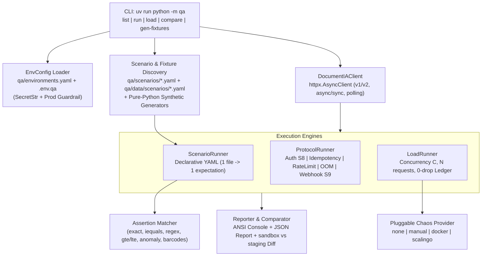
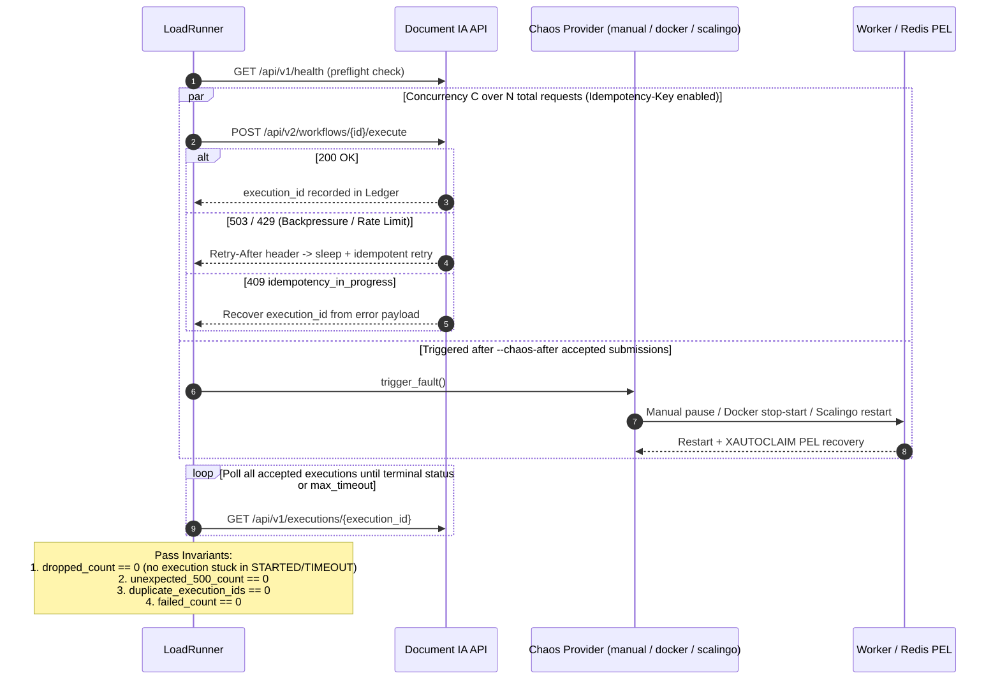

# Document IA QA, Non-Regression & Resilience Toolkit (`qa/`)

**Purpose**: End-to-end quality assurance, cross-environment non-regression testing (`sandbox` vs `staging`/`develop`), security hardening verification (Initiative `#151`), and concurrent load + chaos (fault injection) testing with zero-drop validation.

---

## 1. Executive Summary & Architectural Principles

The `qa/` toolkit is a standalone Python package living at the monorepo root **outside `[tool.uv.workspace]`** so that it introduces **zero external dependencies**, leaves `uv.lock` untouched, and does not affect Scalingo buildpacks or OSV vulnerability policy gates (`#167`). It runs directly inside the existing workspace `.venv` (`httpx`, `pydantic`, `pyyaml`, `pytest`).

### Core Capabilities
1. **Multi-Environment Execution**: Target `local`, `sandbox`, `staging` (alias: `develop`), or `prod` (strictly guarded by `--allow-prod`, with load & chaos permanently disabled on production).
2. **Declarative 1-File / 1-Expected-Result Scenarios (YAML)**: Easily add functional non-regression scenarios with an AI/LLM-aware assertion engine (`iequals`, `contains`, `regex`, `gte`/`lte`, `anomaly_code`, `barcodes`, `headers`, `json_path`).
3. **Zero-PII Synthetic Mode + On-Demand Real Documents**:
   - Built-in pure-Python generators (`synthetic:*`) produce valid PDFs, PNGs, MIME-spoofed files, impossible-date documents (`#170`), and a 110 MP decompression-bomb PNG (`#258`) for immediate standalone and CI execution.
   - Real local documents and private scenario files stay in gitignored `qa/data/` (or any `--fixtures-dir` / `QA_FIXTURES_DIR`), ensuring PII never enters Git.
4. **Protocol Security & Resilience Verification**: Multi-step automated tests covering API key cryptographic binding (`#159`), rate-limit privacy & quotas (`#250`), `Idempotency-Key` lifecycle (`#148`), Anti-SSRF (`#152`), OOM decompression-bomb survival (`#258`), and cross-tenant webhook isolation (`#160`).
5. **Load Testing & Chaos Fault Injection**: Concurrent workflow stress runner with pluggable chaos providers (`none`, `manual`, `docker`, `scalingo`), `503`/`429` `Retry-After` handling, idempotent retries, latency percentiles (`p50`/`p95`/`p99`), and strict **0-drop verification** across restarts and PEL recovery (`#130`, `#131`, `#234`).
6. **Cross-Environment Regression Diff (`qa compare`)**: Export structured JSON reports per run and diff `sandbox` (current production baseline) against `staging` (`develop`) to catch functional or latency regressions before release.

---

## 2. System Architecture



---

## 3. Environment Setup & Security Controls

### 3.1 Secret Management (`.env.qa`)
API keys are **never** stored in `qa/environments.yaml` or scenario files. Copy `.env.qa.example` to `.env.qa` (gitignored):

```bash
cp .env.qa.example .env.qa
```

Populate only the environments you need:

```dotenv
QA_LOCAL_API_KEY=dia_dev_2_...
QA_SANDBOX_API_KEY=dia_sandbox_1_...
QA_STAGING_API_KEY=dia_staging_2_...

# Optional: only required for opt-in --tags webhook
QA_STAGING_ADMIN_API_KEY=dia_staging_2_...
QA_WEBHOOK_URL=https://example.com/qa-webhook

# Optional: external directory holding real documents & private scenarios/
QA_FIXTURES_DIR=/path/to/my/local-qa-docs
```

Environment variables already exported in the shell take precedence over `.env.qa`.

### 3.2 Environment Profiles & Production Guardrails

| Environment | Aliases | Default Base URL | Profile | Load / Chaos Allowed | Extra Guard |
|---|---|---|---|---|---|
| `local` | — | `http://localhost:8000` | `develop` | Yes / Yes | None |
| `sandbox` | — | `https://api.sandbox.document-ia.beta.gouv.fr` | `baseline` | Yes / Yes | None |
| `staging` | `develop` | `https://api.staging.document-ia.beta.gouv.fr` | `develop` | Yes / Yes | None |
| `prod` | — | `https://api.document-ia.beta.gouv.fr` | `baseline` | **No / No** | Requires `--allow-prod` |

### 3.3 Built-in Security Invariants
- **Secret Redaction**: All API keys are wrapped in Pydantic `SecretStr`, stripped from headers (`sanitize_headers`), and redacted as `***REDACTED***` in header assertion outputs before console printing or JSON report serialization.
- **Production Hostname & Scalingo App Guardrail**: Production protection is enforced both by environment name **and** by resolved URL hostname (so `--base-url` or `QA_*_BASE_URL` pointing to `api.document-ia.beta.gouv.fr` cannot bypass `ProdGuardError`). `ScalingoChaosProvider` additionally blocks any `--scalingo-app` containing `prod` / `production`.
- **Fixture Path Confinement**: Relative fixture paths in YAML scenarios are strictly confined inside `--fixtures-dir` (`FixturePathTraversalError` raised on `../` or symlink escapes), and `gen-fixtures` refuses to overwrite symlinks.
- **Safe Subprocess Execution**: `DockerChaosProvider` and `ScalingoChaosProvider` validate container/app identifiers against strict regex patterns and invoke `subprocess.run(..., shell=False, timeout=60.0)` exclusively.

---

## 4. Quick Start & Release Validation Workflow

### 4.1 Discover Available Scenarios & Synthetic Fixtures

```bash
uv run python -m qa list --env staging
```

### 4.2 Compare `sandbox` (Prod Baseline) vs `staging` (`develop`)

```bash
# 1. Run baseline suite on sandbox (current prod-equivalent version)
uv run python -m qa run --env sandbox --tags baseline --report qa/reports/sandbox.json

# 2. Run full non-destructive suite (baseline + security + idempotency + resilience) on staging (develop)
uv run python -m qa run --env staging --report qa/reports/staging.json

# 3. Diff sandbox vs staging to detect any functional or latency regression
uv run python -m qa compare qa/reports/sandbox.json qa/reports/staging.json
```

`qa compare` exits with code `1` if any scenario regresses from `PASS` to `FAIL` (or if `--fail-on-functional-diff` is set and extracted outputs diverge).

### 4.3 Run Real-Document Scenarios On Demand

1. Copy the template into the gitignored local directory:
   ```bash
   mkdir -p qa/data/scenarios
   cp qa/scenarios/real_documents.yaml.example qa/data/scenarios/real_documents.yaml
   ```
2. Drop your real PDF/image files in `qa/data/` and edit expected field values in `qa/data/scenarios/real_documents.yaml`.
3. Execute against `sandbox` and `staging`, then compare:
   ```bash
   uv run python -m qa run --env sandbox --tags real --strict-fixtures --report qa/reports/sandbox_real.json
   uv run python -m qa run --env staging --tags real --strict-fixtures --report qa/reports/staging_real.json
   uv run python -m qa compare qa/reports/sandbox_real.json qa/reports/staging_real.json --fail-on-functional-diff
   ```

> [!NOTE]
> If a YAML scenario references a local file that does not exist on the machine (e.g., in CI), the runner marks it `SKIPPED` by default instead of failing. Pass `--strict-fixtures` to turn missing files into hard failures.

> [!WARNING]
> **PII Hygiene on JSON Reports**: Reports generated from real documents include extracted property snapshots (`snapshot.extraction_properties`, e.g. names, birth dates, fiscal data). Always write reports under the gitignored `qa/reports/` directory and never commit real-document reports to Git.

---

## 5. Authoring Declarative Scenarios (YAML)

Any `.yaml` or `.yml` file placed in `qa/scenarios/` or `<fixtures-dir>/scenarios/` is automatically discovered.

### 5.1 Scenario Schema Example

```yaml
scenarios:
  - id: real-cni-dupont
    description: "French CNI: classification + key extracted fields"
    tags: [baseline, functional, real, v2]
    # min_profile: develop   # Optional: skipped on baseline envs (e.g. sandbox) unless targeted
    request:
      api_version: v2        # v1 | v2
      mode: async            # async (execute + poll) | sync (execute-sync) | http (direct endpoint)
      workflow_id: document-classification-extraction-v2
      file: cni/dupont.pdf   # Relative to --fixtures-dir, or synthetic:<name>
      # file_url: https://... # Mutually exclusive with file
      override:
        extract_content_ocr:
          - param: model
            value: mistral
      metadata:
        qa_scenario: real-cni-dupont
    expect:
      http_status: 200       # int or list[int], e.g. [400, 422]
      execution_status: SUCCESS
      purged: false          # Verified on develop profile / when field is present
      classification:
        document_type: cni   # Exact string or { one_of: [cni, passeport] }
        confidence: { gte: 0.75 }
      extraction:
        type: cni
        properties:
          nom: { iequals: "DUPONT" }
          prenom: { contains: "Jean" }
          date_naissance: { equals: "1990-05-14" }
          # Example for impossible calendar date (#170):
          # date_expiration: { is_null: true, anomaly_code: "invalid_date", anomaly_raw_value: "31/04/2026" }
      barcodes:
        min_count: 0
        # contains_type: "2D_DOC"
      headers:
        exists: [x-ratelimit-remaining-minute]
```

### 5.2 Supported Matcher Operators

| Operator | Description | Example |
|---|---|---|
| `equals` / `not_equals` | Exact equality | `{ equals: "2024" }` |
| `iequals` | Normalized string match (accent-insensitive, case-insensitive, collapsed whitespace) | `{ iequals: "Élodie DUPONT" }` |
| `contains` / `regex` | Substring or regular expression match | `{ regex: "^[0-9]{14}$" }` |
| `one_of` | Value must belong to allowed set | `{ one_of: ["cni", "passeport"] }` |
| `gte` / `lte` / `between` | Numeric range comparisons | `{ gte: 0.75 }`, `{ between: [0.5, 1.0] }` |
| `is_null` / `not_empty` / `exists` | Presence / nullability checks | `{ not_empty: true }` |
| `anomaly_code` / `anomaly_raw_value` | Validates date anomaly metadata (`#170`) | `{ is_null: true, anomaly_code: "invalid_date" }` |
| `json_path` | Dot-path assertions on raw JSON payload (supports `$length`) | `data.$length: { gte: 4 }` |

### 5.3 Built-in Pure-Python Synthetic Fixtures (`synthetic:*`)

Generate them on disk at any time with `uv run python -m qa gen-fixtures`:

| Fixture Name | MIME Type | Purpose |
|---|---|---|
| `synthetic:minimal_pdf` | `application/pdf` | Valid 1-page French administrative PDF for smoke/v1/v2/load tests |
| `synthetic:cni_pdf` | `application/pdf` | Structured CNI-like text PDF (`DUPONT`, `JEAN`, `14/05/1990`) |
| `synthetic:invalid_date_pdf` | `application/pdf` | Synthetic document containing impossible calendar date `31/04/2026` (`#170`) |
| `synthetic:multipage_pdf` | `application/pdf` | Valid 3-page PDF for multi-page OCR/load testing |
| `synthetic:valid_png` | `image/png` | Valid RGB PNG image for image ingestion & sync workflow tests |
| `synthetic:fake_pdf_shell` | `application/pdf` | Shell script disguised as `.pdf` to verify MIME spoofing rejection (`#152`) |
| `synthetic:decompression_bomb_png` | `image/png` | Valid PNG (< 50 KB compressed) declaring `11000 x 10000` (110 MP > `MAX_BARCODE_IMAGE_PIXELS`) to verify OOM guard (`#258`) |

---

## 6. Protocol Security & Resilience Matrix

| Scenario ID | Default on `staging` | Reference | Verified Behavior |
|---|---|---|---|
| `proto-auth-binding` | Yes | `#159`, `#250` | Rejects missing, random, wrong-env, mutated-prefix, and `v`-prefixed keys with `401` without consuming valid key's rate-limit quota. |
| `proto-idempotency` | Yes | `#148` | Validates first submission (`200`), identical replay (`200` + `Idempotent-Replay: true` + same `execution_id`), payload conflict (`409 idempotency_conflict`), invalid key (`400 invalid_idempotency_key`), and concurrent duplicate (1 single `execution_id`). |
| `proto-ratelimit-headers` | Yes | `#250` | Verifies presence and consistent decrements of `X-RateLimit-Remaining-Minute` / `Daily` and `Reset-*` headers. |
| `proto-oom-decompression-bomb` | Yes | `#258` | Submits 110 MP PNG (validates safe handling: `400`/`413`/`422`, `FAILED`, or `SUCCESS` with `barcodes: []` when skipped by `MAX_BARCODE_IMAGE_PIXELS` guard), then immediately submits a valid PDF and confirms `SUCCESS` (proving worker survived without OOM kill). |
| `proto-ratelimit-burst` | Opt-in (`--tags ratelimit-burst`) | `#250` | Triggers `429 Too Many Requests`, checks `Retry-After`, and verifies daily quota is preserved on rejected calls. |
| `proto-webhook-isolation` | Opt-in (`--tags webhook`, needs admin key) | `#160` | Creates temporary webhook on org A, verifies cross-org `DELETE` via org B returns `404`, and always cleans up in `finally`. |

---

## 7. Load Testing & Chaos Fault Injection (`qa load`)

### 7.1 Execution Flow



### 7.2 Usage Examples

#### A. Standard Load Test (Pure Concurrency, Zero Drops)
```bash
uv run python -m qa load \
  --env staging \
  -n 25 -c 8 \
  --workflow-id document-barcode-extraction-v2 \
  --files synthetic:minimal_pdf,synthetic:multipage_pdf \
  --report qa/reports/staging_load.json
```

#### B. Load Test with Manual Scalingo Crash Recovery (`--chaos-mode manual`)
The runner pauses after `--chaos-after` accepted executions, prompts you to kill/restart the Scalingo worker (or API) instance, and then verifies **0 dropped executions** once polling finishes (default timeout auto-extends to `360s` to cover Redis `reclaim_idle_ms = 300s`):

```bash
uv run python -m qa load \
  --env staging \
  -n 15 -c 5 \
  --workflow-id document-classification-extraction-v2 \
  --files qa/data/cni/cni_sample.pdf \
  --chaos-mode manual \
  --chaos-after 5 \
  --max-timeout 420 \
  --report qa/reports/staging_chaos_manual.json
```

#### C. Automated Scalingo Restart (`--chaos-mode scalingo`)
```bash
uv run python -m qa load \
  --env staging \
  -n 15 -c 5 \
  --chaos-mode scalingo \
  --scalingo-app document-ia-worker-staging \
  --chaos-target worker \
  --chaos-after 4 \
  --max-timeout 420
```

#### D. Local Docker Redis Outage Check (`--chaos-mode docker`)
Stops `document-ia-redis` mid-run, verifies `#149` invariants (`GET /api/v1/executions/{id}` stays `200 OK` while new `POST` fails closed with `503`), restarts Redis, and confirms all in-flight jobs recover with 0 drops:

```bash
uv run python -m qa load \
  --env local \
  -n 10 -c 4 \
  --chaos-mode docker \
  --chaos-target document-ia-redis \
  --chaos-downtime-s 5 \
  --chaos-after 3
```

---

## 8. Running Unit Tests & Quality Checks

The QA toolkit itself is covered by a full offline unit test suite using `httpx.MockTransport`:

```bash
uv run pytest qa/tests -v
uv run ruff check qa
uv run ruff format --check qa
uv run pyright qa
```
