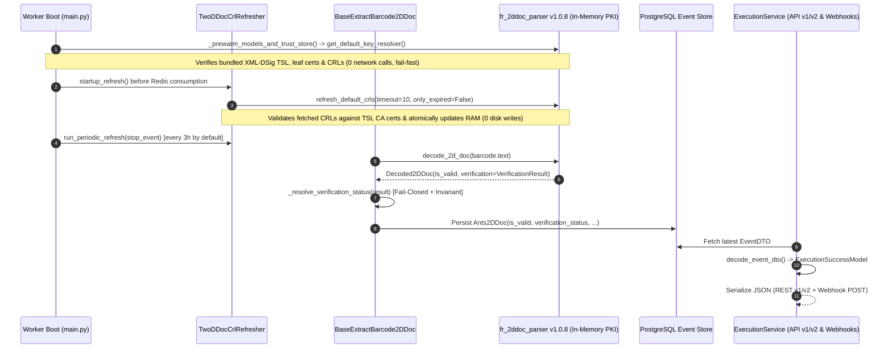

# Security Architecture: 2D-Doc Cryptographic Verification & `VerificationStatus` Exposure

**Initiative**: #151 - Security Hardening
**Upstream Dependency**: `betagouv/2ddoc-parser` **v1.0.8** ([PR #13](https://github.com/betagouv/2ddoc-parser/pull/13) & [PR #17](https://github.com/betagouv/2ddoc-parser/pull/17), resolving `etalab-ia/document-ia#161` / T1)
**Scope**: Security integration milestone preparatory to `#162` (T2) — exposes 2D-Doc signature/PKI verification status across `document-ia-infra`, `document-ia-worker`, `document-ia-api` (v1/v2 + OpenAPI/ReDoc), and webhooks, and maintains fresh in-memory 2D-Doc CRLs across long-running worker lifecycles. Functional OCR vs. 2D-Doc field reconciliation is intentionally out of scope of this milestone.

---

## 1. Executive Summary

Prior to integrating `2ddoc-parser v1.0.7` / `v1.0.8`, `Ants2DDoc` exposed only a coarse boolean `is_valid: bool`, making it impossible for downstream consumers to distinguish between a cryptographically invalid signature, a missing signature, an unknown or revoked certificate, an expired Trust Status List (TSL), or an unavailable resolver. Furthermore, the worker did not pre-verify the 2D-Doc offline PKI trust store at startup or keep short-lived CA revocation lists (CRLs) up to date in memory.

This integration enforces:
1. **Single Source of Truth for `VerificationStatus`**: `Ants2DDoc.verification_status` directly reuses `fr_2ddoc_parser.model.models.VerificationStatus` in `document-ia-infra` (zero enum duplication). FastAPI / OpenAPI / ReDoc automatically documents all 10 enum values.
2. **Strict Non-Exposure of Internal Diagnostics (OWASP A05 / A09)**: Only the closed `VerificationStatus` enum is persisted and returned. Internal diagnostic fields from `VerificationResult` (notably `detail`, which may include raw exception strings or local filesystem paths) are never exposed in persisted events, API responses, or webhooks.
3. **Fail-Closed Worker Mapping & `is_valid` Invariant**: `BaseExtractBarcode2DDoc._resolve_verification_status()` guarantees that `is_valid` can only be `True` when `result.is_valid is True` **and** `verification_status == VerificationStatus.VERIFIED`. Missing or unrecognized verification statuses fail closed to `(VerificationStatus.RESOLVER_UNAVAILABLE, False)`.
4. **Offline Boot Pre-Warming**: `_prewarm_models_and_trust_store()` in `document-ia-worker/src/document_ia_worker/main.py` loads and verifies the bundled offline ANTS PKI trust store at worker startup (~95 ms, zero network I/O), logs any bundled expired CRL CAs via `get_expired_crl_cas()`, and fails fast if the trust store is corrupted or unreadable.
5. **Startup & Periodic In-Memory CRL Refresh**: `TwoDDocCrlRefresher` (`document-ia-worker/src/document_ia_worker/core/two_ddoc_crl_refresher.py`) refreshes CRLs in memory via `refresh_default_crls(timeout=..., only_expired=False)` at worker startup (before consuming the first Redis message) and periodically every 3 hours by default so both expiring CRLs and ahead-of-schedule certificate revocations are detected without disk writes.
6. **Backward Compatibility**: `verification_status` defaults to `None` so historical `WorkflowExecutionCompletedEvent` records stored in PostgreSQL decode without error across REST v1/v2 endpoints and webhooks.

---

## 2. End-to-End Verification & Exposure Flow



---

## 3. Contract & `VerificationStatus` Semantics

`Ants2DDoc` ([`document-ia-infra/src/document_ia_infra/data/event/schema/barcode.py`](../document-ia-infra/src/document_ia_infra/data/event/schema/barcode.py)) exposes:

| Field | Type | Default | Privacy (`x-mask`) | Notes |
| :--- | :--- | :--- | :--- | :--- |
| `is_valid` | `bool` | *(required)* | No | `True` **if and only if** `verification_status == "verified"` for newly processed 2D-Docs. |
| `verification_status` | `VerificationStatus \| None` | `None` | No | `None` only for historical persisted events predating this release. |
| `raw_data` | `Any \| None` | `None` | **Yes** (`x-mask: True`) | Raw decoded fields. |
| `typed_data` | `list[GenericProperty]` | `[]` | **Yes** (`x-mask: True`) | Typed decoded fields. |

### `VerificationStatus` Enum Values (`fr_2ddoc_parser.model.models.VerificationStatus`)

| Value | `is_valid` | Meaning |
| :--- | :---: | :--- |
| `verified` | `true` | Cryptographic signature verified against a valid, non-revoked leaf certificate chaining up to a fresh ANTS TSL. |
| `signature_missing` | `false` | 2D-Doc payload does not contain a signature block. |
| `signature_invalid` | `false` | Cryptographic signature verification failed against the resolved certificate(s). |
| `unknown_ca` | `false` | Issuing CA identifier (`ca_id`, e.g., excluded test CA `FR00`) is not present in the trust store. |
| `unknown_cert` | `false` | Signing certificate identifier (`cert_id`) is not found under the declared CA. |
| `untrusted_certificate` | `false` | Certificate failed X.509 chain, constraints, key usage, or trust-anchor validation. |
| `cert_revoked` | `false` | Signing certificate is listed as revoked in an applicable signed CRL. |
| `cert_not_valid_at_signing` | `false` | Signing certificate was not valid at the document reference date (`signature_date` or `issue_date`). |
| `trust_list_expired` | `false` | Bundled or overridden TSL `NextUpdate` has elapsed under strict freshness policy (fail-closed). |
| `resolver_unavailable` | `false` | Trust store unavailable, required CRL missing/expired/unapplicable, or worker fail-closed fallback triggered. |

> [!WARNING]
> **Security Interpretation**:
> - The absence of a 2D-Doc barcode on a document does **not** prove fraud.
> - A `verified` signature proves the cryptographic integrity and ANTS PKI provenance of the **barcode payload only** — it does **not** prove the authenticity of the surrounding image, the consistency with OCR-extracted text, or the identity of the document holder.

---

## 4. Security Controls & Threat Matrix

| Threat / Failure Mode | OWASP | Control Implemented |
| :--- | :--- | :--- |
| **Internal Error / Path Disclosure** | A05 / A09 | `VerificationResult.detail` and internal PKI metadata (`ca_id`, `cert_id`, `tsl_*`) are excluded from `Ants2DDoc`. Worker logs emit only non-PII status/mismatch/CRL summary warnings; unexpected CRL refresh exceptions log only `type(exc).__name__`. |
| **Status / Boolean Desynchronization** | A04 / A08 | `_resolve_verification_status()` enforces `is_valid = bool(result.is_valid and status == VerificationStatus.VERIFIED)`. Any `is_valid=True` paired with a non-`verified` status is forced to `False` with a `WARNING` log. |
| **Upstream Library Drift / Missing Verification Object** | A04 | If `result.verification is None` or `result.verification.status` is not a valid `VerificationStatus`, the worker fails closed to `(VerificationStatus.RESOLVER_UNAVAILABLE, False)` rather than crashing or marking the barcode valid. |
| **Stale CRLs / Delayed Revocation Detection** | A07 / A08 | ANTS CA CRLs expire every 3 to 7 days and may be re-issued ahead of schedule on certificate revocation. `TwoDDocCrlRefresher` refreshes CRLs in memory at worker startup and every 3 hours by default (`only_expired=False`), validating each downloaded CRL against the TSL CA certificate before atomic replacement. |
| **Per-Document Network Dependency / SSRF** | A10 | `decode_2d_doc()` performs 100% offline PKI validation against the in-memory trust store. CRL fetching is restricted to explicit background `TwoDDocCrlRefresher` cycles targeting only CDP URLs extracted from verified TSL-anchored certificates, never URLs from user documents. |
| **Offline Environments & Read-Only Containers** | A05 / A08 | `_prewarm_models_and_trust_store()` performs zero network calls (preserving `--network none` CD smoke tests). `TwoDDocCrlRefresher` writes nothing to disk, degrades gracefully on network failure without crashing the worker, and never evicts a valid in-memory CRL. |
| **Corrupted Trust Store at Runtime** | A08 | `_prewarm_models_and_trust_store()` invokes `get_default_key_resolver()` at worker startup and aborts boot on load/integrity errors. |
| **Historical Event Deserialization Regression** | A04 | `Ants2DDoc.verification_status` defaults to `None`, preserving compatibility with historical PostgreSQL events, REST API v1/v2, and webhooks. |

---

## 5. Operations, Trust Store & CRL Lifecycle

### Bundled Trust Store (`2ddoc-parser v1.0.8`)
- **TSL Sequence Number**: `23`
- **TSL `NextUpdate`**: `2027-05-11T14:00:00Z`
- **Boot Pre-Warm Load Time**: ~95 ms (0 network calls)
- **Boot Freshness Logging**: `_prewarm_models_and_trust_store()` logs `tsl_sequence_number`, `tsl_next_update`, and `tsl_freshness` at `INFO` level, emits a `WARNING` if `tsl_freshness != TrustListFreshness.FRESH`, and logs any bundled expired CRL CAs via `resolver.get_expired_crl_cas()` (without blocking boot).

### In-Memory CRL Lifecycle & Periodic Refresh
While the ANTS TSL is valid for roughly one year, individual CA CRLs typically have a **TTL of 3 to 7 days** and can also be republished ahead of schedule whenever a signing certificate is revoked.

To keep revocation status accurate in long-running workers without rebuilding container images or writing to disk:
- **Startup Refresh**: In `run_consumer()`, immediately after `_prewarm_models_and_trust_store()` and **before** `start_consumer()` reads the first Redis message, `TwoDDocCrlRefresher.startup_refresh()` executes `refresh_default_crls(timeout=..., only_expired=False)` in a worker thread (`asyncio.to_thread`).
- **Periodic Refresh**: A background `asyncio.Task` (`run_periodic_refresh(stop_event)`) runs every **3 hours by default** with `only_expired=False` so early/emergency revocations are detected within one refresh interval even when the current CRL has not yet expired.
- **Cryptographic Verification & Atomic Swap**: `2ddoc-parser v1.0.8` verifies every downloaded CRL signature against its TSL-anchored CA certificate and rejects older CRLs before atomically swapping the in-memory CRL entry under a lock.
- **Read-Only Container Compatibility**: All refreshed CRLs live strictly in memory (zero filesystem writes).
- **Graceful Offline Degradation**: If outbound HTTP access is unavailable (air-gapped environments, transient CA outage, or `--network none`), `TwoDDocCrlRefresher` logs a non-PII warning, keeps the existing in-memory CRLs intact, and never crashes the worker. Individual CAs with expired/unavailable CRLs remain fail-closed (`resolver_unavailable`).

### CRL Refresh Configuration (`BarcodeSettings`)

| Environment Variable | Type | Default | Description |
| :--- | :--- | :--- | :--- |
| `TWO_D_DOC_CRL_REFRESH_ENABLED` | `bool` | `True` | Enable/disable startup and periodic in-memory 2D-Doc CRL refresh. |
| `TWO_D_DOC_CRL_REFRESH_INTERVAL_HOURS` | `float` (`> 0`) | `3.0` | Interval in hours between periodic in-memory 2D-Doc CRL refreshes. |
| `TWO_D_DOC_CRL_REFRESH_TIMEOUT_SECONDS` | `int` (`> 0`) | `10` | Per-CRL HTTP fetch timeout in seconds during a refresh cycle. |

### Operational Trust Store Override (`FR_2DDOC_TRUST_STORE_DIR`)
To refresh the ANTS TSL and CA certificates before `2027-05-11` without rebuilding container images, operators can mount an updated offline trust store directory (generated via `python -m fr_2ddoc_parser.crypto.sync_trust_store`) and set:

```bash
FR_2DDOC_TRUST_STORE_DIR=/path/to/verified-trust-store
```

### Known Snapshot Limitation (`FR01`)
In the `2ddoc-parser` bundled snapshot, the CRL for legacy authority `FR01` expired in 2022 and its upstream CDP no longer serves a fresh CRL. By design (fail-closed revocation checking), 2D-Docs signed by `FR01` return `is_valid: false` and `verification_status: "resolver_unavailable"`. All active issuing authorities are refreshed in memory and remain unaffected.

---

## 6. Example API Response (`Ants2DDoc`)

```json
{
  "type": "2D_DOC",
  "page_number": 1,
  "position": {
    "top_left": [100, 100],
    "top_right": [250, 100],
    "bottom_right": [250, 250],
    "bottom_left": [100, 250]
  },
  "is_valid": true,
  "verification_status": "verified",
  "raw_data": {"01": "EXAMPLE"},
  "typed_data": [
    {"name": "first_name", "value": "Alice", "type": "string"}
  ],
  "issue_date": "2026-01-01",
  "ants_type": "01",
  "doc_type": "01"
}
```
