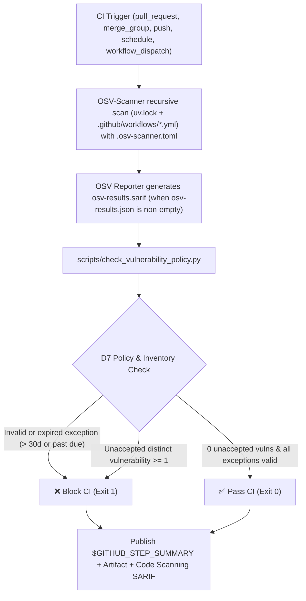
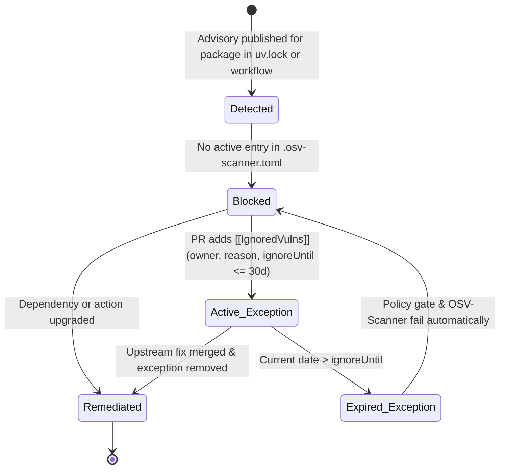

# Vulnerability & Secret Management Policy (Decision D7)

**Initiative:** `#151` — Security Hardening
**Milestone / Issue:** `I2` — `#167` (Make vulnerability controls enforceable)
**Architectural Decision:** `D7` (Accepted — 30-day maximum exception cap, full-inventory blocking gate across all CI events)
**Owner:** `@nicolasSagon`

---

## 1. Purpose and Scope

This document defines the enforceable vulnerability and secret detection policy for the **Document IA** monorepo. It implements architectural decision **D7**:

> *"A visible but non-blocking detection is not a risk decision. Any new unaccepted vulnerability and any expired exception must block delivery."*

The ratified **D7** parameters are:
- **Maximum exception horizon**: **30 days** (`DEFAULT_MAX_EXPIRATION_DAYS = 30`).
- **Enforcement mode**: **Full-inventory blocking gate** across all CI events (`pull_request`, `merge_group`, `push` on `main`/`develop`, weekly `schedule`, and `workflow_dispatch`).

The policy covers two complementary controls executed in GitHub Actions and local developer hooks:
1. **Dependency & Workflow Vulnerability Control (OSV-Scanner & D7 Policy Gate)**: Recursively scans the repository (`--recursive ./`) covering both the consolidated workspace lockfile ([`uv.lock`](../uv.lock)) and GitHub Actions workflows (`.github/workflows/*.yml`, `document-ia-schemas/.github/workflows/*.yml`), enforces the temporary exception rules in [`.osv-scanner.toml`](../.osv-scanner.toml) via [`scripts/check_vulnerability_policy.py`](../scripts/check_vulnerability_policy.py), and produces deduplicated reports. Note that `osv-scanner` v2 skips symlinks (`ReadSymlinks: false`), so the sub-project symlinks `document-ia-*/uv.lock -> ../uv.lock` are not duplicated.
2. **Secret Detection Control (Gitleaks & Synthetic Probe)**: Scans the complete Git history against [`.gitleaks.toml`](../.gitleaks.toml) and the frozen historical baseline [`.gitleaks-baseline.json`](../.gitleaks-baseline.json), and verifies active rule enforcement on every CI run using [`scripts/verify_gitleaks_synthetic.sh`](../scripts/verify_gitleaks_synthetic.sh).

---

## 2. Dependency Vulnerability Control Architecture (D7)

### 2.1. End-to-End CI Enforcement Flow

Unlike differential-only PR checks that miss newly published CVEs or newly expired exceptions on unchanged dependencies, [`.github/workflows/osv-scanner.yml`](../.github/workflows/osv-scanner.yml) runs a **full-inventory blocking gate** across all triggers (`pull_request`, `merge_group`, `push` on `main`/`develop`, `schedule`, and `workflow_dispatch`).



### 2.2. Distinguishing Distinct Vulnerabilities from Lockfile Occurrences

A raw OSV scan output must never be reported as a count of distinct vulnerabilities:
- A single advisory is frequently cross-published under multiple identifiers (`CVE-*`, `GHSA-*`, `PYSEC-*`) linked through exact `aliases` (and `groups` alias groupings). By contrast, `related` and `upstream` refer to distinct vulnerabilities and are **never** merged, preventing exception bypasses across separate advisories.
- A single vulnerability can affect multiple package entries or lockfile/workflow references.

[`scripts/check_vulnerability_policy.py`](../scripts/check_vulnerability_policy.py) computes three separate metrics using a **Union-Find (connected components)** algorithm over exact linked alias identifiers (`id ∪ aliases` across vulnerability entries and `groups`):

| Metric | Definition | Role in Policy Gate |
| :--- | :--- | :--- |
| **Distinct Unaccepted Vulnerabilities** | Connected components of exact linked vulnerability aliases (`CVE` / `GHSA` / `PYSEC`) not covered by an active D7 exception. Canonical ID prioritizes `CVE-*`, then `GHSA-*`, then `PYSEC-*`, then lexicographical order. | **Blocking metric** (`> 0` fails CI). |
| **Affected Package Occurrences** | Unique `(package_name, package_version, lockfile_path)` tuples impacted by at least one unaccepted vulnerability. | Operational remediation scope. |
| **Raw OSV Findings** | Unmerged count of vulnerability entries in `osv-results.json`. | Informational only (prevents inflation). |

---

## 3. Temporary Exception Governance (`.osv-scanner.toml`)

When an upstream fix is unavailable or a vulnerability lies in an unreachable code path, a temporary risk exception may be recorded in [`.osv-scanner.toml`](../.osv-scanner.toml) via Pull Request.

### 3.1. Mandatory Schema and Constraints

Every `[[IgnoredVulns]]` entry in [`.osv-scanner.toml`](../.osv-scanner.toml) is validated by [`scripts/check_vulnerability_policy.py`](../scripts/check_vulnerability_policy.py) against the following rules:

| Field | Format / Constraint | Failure Code on Violation |
| :--- | :--- | :--- |
| `id` | Official advisory ID matching `^(GHSA-[a-z0-9]{4}-[a-z0-9]{4}-[a-z0-9]{4}\|CVE-\d{4}-\d{4,}\|PYSEC-\d{4}-\d+)$`. Must be unique. | `INVALID_VULN_ID` / `DUPLICATE_VULN_ID` |
| `ignoreUntil` | Mandatory **unquoted** TOML date `YYYY-MM-DD` (`datetime.date`, neither a quoted string nor `datetime.datetime`, matching OSV-Scanner Go's TOML parser). Must satisfy `today <= ignoreUntil <= today + 30 days`. | `MISSING_IGNORE_UNTIL` / `INVALID_IGNORE_UNTIL` / `EXPIRED_EXCEPTION` / `EXCESSIVE_EXPIRATION_HORIZON` |
| `reason` | Mandatory string matching `^\[Owner:\s*@([A-Za-z0-9-]+)\]\s*(.{20,})$` (explicit GitHub owner handle + at least 20 characters of technical justification or compensating control). | `MISSING_REASON` / `INVALID_REASON_FORMAT` / `SHORT_REASON_JUSTIFICATION` |

> [!WARNING]
> Unbounded overrides (such as entries without `ignoreUntil`, quoted `ignoreUntil` strings, horizons exceeding **30 days**, or top-level keys other than `IgnoredVulns`) are automatically rejected by the CI policy gate.

### 3.2. Example of a Compliant Exception

```toml
[[IgnoredVulns]]
id = "GHSA-xxxx-yyyy-zzzz"
ignoreUntil = 2026-12-10
reason = "[Owner: @nicolasSagon] Transitive dependency in dev/evals only; affected function is never called. Waiting for upstream release."
```

### 3.3. Exception Lifecycle



---

## 4. Secret Detection & Synthetic Probe Verification (Gitleaks)

### 4.1. Defense-in-Depth Layers

1. **Local Pre-Commit Hook** ([`.pre-commit-config.yaml`](../.pre-commit-config.yaml)): Runs `gitleaks` on staged index changes.
2. **Local Pre-Push Hook** ([`scripts/pre-push`](../scripts/pre-push) & [`scripts/gitleaks_pre_push.sh`](../scripts/gitleaks_pre_push.sh)): Scans every outgoing commit range across all pushed references.
3. **CI Full-History Scan** ([`.github/workflows/document-ia-ci.yml`](../.github/workflows/document-ia-ci.yml)): Runs `gitleaks git --config .gitleaks.toml --baseline-path .gitleaks-baseline.json --verbose --redact .` on `fetch-depth: 0`.
4. **CI Synthetic Probe & Baseline Integrity Check** ([`scripts/verify_gitleaks_synthetic.sh`](../scripts/verify_gitleaks_synthetic.sh)):
   - Asserts that [`.gitleaks-baseline.json`](../.gitleaks-baseline.json) contains **strictly** the 3 known historical fingerprints (no silent additions allowed).
   - Creates an isolated ephemeral Git repository outside the workspace (`mktemp -d`), dynamically constructs a synthetic Document IA token (`dia_prod_v1_...`) and a high-entropy generic secret at runtime (so no literal secret exists in the repository), and verifies that Gitleaks exits with a non-zero status code and triggers both `document-ia-token` and `generic-api-key`.

---

## 5. Local Verification & Operational Runbook

### 5.1. Running the Policy and Secret Checks Locally

```bash
# 1. Validate .osv-scanner.toml governance rules (30-day max horizon, owner, justification)
python3 scripts/check_vulnerability_policy.py \
  --config .osv-scanner.toml \
  --summary-output /tmp/vulnerability-summary.md

# 2. Validate against an OSV-Scanner JSON report
python3 scripts/check_vulnerability_policy.py \
  --config .osv-scanner.toml \
  --osv-json osv-results.json \
  --summary-output /tmp/vulnerability-summary.md

# 3. Run the Gitleaks baseline & synthetic secret probe
bash scripts/verify_gitleaks_synthetic.sh

# 4. Run the automated pytest suite
cd document-ia-infra && uv run pytest tests/document_ia_infra/core/security/test_vulnerability_policy.py
```

### 5.2. GitHub Branch Protection Configuration (Linked to `#124`)

To make CI failures strictly enforceable at the repository level on `develop` and `main`, the following GitHub Actions status checks must be configured as **Required Status Checks** in the GitHub branch protection rules:

- `OSV-Scanner & Politique D7` (from [`.github/workflows/osv-scanner.yml`](../.github/workflows/osv-scanner.yml))
- `Gitleaks (historique complet)` (from [`.github/workflows/document-ia-ci.yml`](../.github/workflows/document-ia-ci.yml))
- `uv (verrou de workspace)` (from [`.github/workflows/document-ia-ci.yml`](../.github/workflows/document-ia-ci.yml))
- `Ruff lint and Pytest (api)`
- `Ruff lint and Pytest (infra)`
- `Ruff lint and Pytest (worker)`
- `Ruff lint and Pytest (schemas)`
- `Ruff lint and Pytest (evals)`
- `Ruff lint and Pytest (auto-scaler)`
