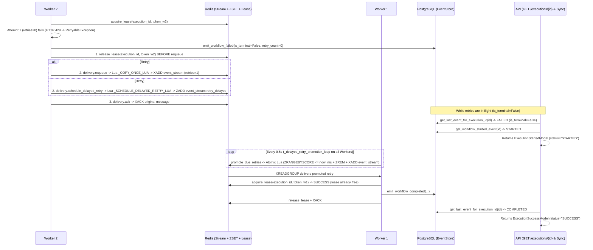

# Worker Retry Backoff, Execution Lease Ordering & Non-Terminal Failure Status

## 1. Overview & Architecture Rationale

When processing document workflows at scale across multiple worker instances and threads, transient downstream failures (such as `HTTP 429 Too Many Requests` from OCR/LLM providers or temporary database connectivity blips) raise `RetryableException`.

To ensure fast, deterministic recovery without false failure signals to API consumers, Document IA enforces four coordinated mechanisms across `document-ia-infra`, `document-ia-worker`, and `document-ia-api`:

1. **Lease-Release-Before-Requeue Ordering**: A worker always releases its Redis execution lease (`lock:workflow_execution:{execution_id}`) **before** requeueing or scheduling a delayed retry, eliminating cross-worker lease contention on immediate retries.
2. **Redis ZSET Delayed Retry Queue (`{stream}:retry_delayed`)**: Bounded retry attempts (`WORKFLOW_MAX_RETRY_NUMBER = 4`, i.e., 1 initial attempt + 3 retries) follow a configurable backoff schedule (`WORKFLOW_RETRY_BACKOFF_DELAYS_S = [0.0, 1.0, 10.0]`) managed via atomic Lua scripts.
3. **Graceful Shutdown Immediate Requeue & 90s PEL Reclaim**: On `SIGTERM`/`SIGINT`, `document-ia-worker` drains in-flight work up to `WORKER_DRAIN_TIMEOUT_S = 20.0s`, then fences unfinished handlers, releases their execution lease, and immediately requeues them with an **unchanged `retries` counter** (`requeue_on_shutdown=True`) before acknowledging the original entry. On abrupt crashes (`SIGKILL`/OOM), surviving workers reclaim idle entries via `XAUTOCLAIM` after `EVENT_STREAM_RECLAIM_IDLE_MS = 90000` ms (90s) while keeping the heartbeat cadence at `30.0s`.
4. **Non-Terminal Failure Event Projection (`is_terminal: bool`)**: Intermediate failure events recorded in PostgreSQL (`WorkflowExecutionFailedEvent` with `is_terminal=False`) preserve full auditability in the Event Store while projecting as `ExecutionStatus.STARTED` (`ExecutionStartedModel`) on `GET /api/v1/executions/{execution_id}` and during synchronous execution polling.

---

## 2. End-to-End Sequence Diagram



---

## 3. Redis Execution Lease & Requeue Ordering

In `BaseConsumer._finalize_done_futures`, the handler's `Future` has already completed (`fut.done() == True`). Releasing the Redis execution lease (`lock:workflow_execution:{execution_id}`) **prior** to calling `_handle_finished_future` guarantees that:

- When Retry #1 (`delay = 0.0s`) is immediately appended to `event_stream` via `XADD`, any peer worker reading the stream via `XREADGROUP` can immediately acquire the lease for `execution_id`.
- No retry message is ever skipped and left stranded in a consumer's Pending Entries List (PEL) waiting for the `EVENT_STREAM_RECLAIM_IDLE_MS` (`XAUTOCLAIM`, 90s default for workflow workers) timeout due to a stale lease from the previous attempt.

---

## 4. Redis ZSET Delayed Retry Architecture

### 4.1 Retry Schedule & Attempt Budget

| Attempt | `retries` Field | Outcome on `RetryableException` | Backoff Delay | Redis Mechanism | `is_terminal` in DB |
| :--- | :--- | :--- | :--- | :--- | :--- |
| **Initial** | `0` | Schedule Retry #1 (`attempts=1`) | `0.0s` | Immediate `XADD` (`requeue`) | `False` |
| **Retry #1** | `1` | Schedule Retry #2 (`attempts=2`) | `1.0s` | Delayed `ZADD` (`{stream}:retry_delayed`) | `False` |
| **Retry #2** | `2` | Schedule Retry #3 (`attempts=3`) | `10.0s` | Delayed `ZADD` (`{stream}:retry_delayed`) | `False` |
| **Retry #3** | `3` (`is_last_retry=True`) | Terminal Failure -> DLQ | N/A | `XADD {stream}:dlq` (`retain`) | `True` |

### 4.2 Atomic Lua Scripts (`StreamDelivery`)

1. **`schedule_delayed_retry` (`_SCHEDULE_DELAYED_RETRY_LUA`)**:
   - **Keys**: `KEYS[1] = {stream}:retry_delayed` (ZSET of `original_id` scored by `due_at_ms`), `KEYS[2] = {stream}`, `KEYS[3] = {stream}:retry_delayed:payloads` (companion HASH mapping `original_id -> JSON fields`).
   - **Idempotence Guard ($O(1)$ ZSET lookup)**:
     - Scans `KEYS[2]` (`XRANGE` from `original_id` to `+`) to verify the message has not already been promoted to the main stream.
     - Checks `ZSCORE KEYS[1] original_id` in **$O(1)$** to verify no entry with the same `original_id` is already scheduled in the ZSET.
     - If absent from both, writes `HSET KEYS[3] original_id payload_json` and `ZADD KEYS[1] due_at_ms original_id`.
   - Protects against duplicate scheduling if `XACK` fails after `schedule_delayed_retry` and the message is subsequently re-processed.

2. **`promote_due_retries` (`_PROMOTE_DUE_RETRIES_LUA`)**:
   - **Keys**: `KEYS[1] = {stream}:retry_delayed`, `KEYS[2] = {stream}`, `KEYS[3] = {stream}:retry_delayed:payloads`.
   - Atomically queries `ZRANGEBYSCORE KEYS[1] -inf now_ms LIMIT 0 batch_size`, removes each due `original_id` via `ZREM`, retrieves and deletes its JSON payload via `HGET`/`HDEL KEYS[3] original_id`, verifies no duplicate `original_id` exists in `KEYS[2]`, and appends the entry to `KEYS[2]` via `XADD`.
   - Executed periodically (every `RETRY_DELAYED_POLL_INTERVAL_S = 0.5s`) by `_delayed_retry_promotion_loop` on all active consumers. Because the ZSET and companion HASH reside in Redis and promotion is atomic, delayed retries survive individual worker restarts without loss or duplication.

### 4.3 Configuration Settings (`RedisSettings`)

| Environment Variable | Default | Constraints | Description |
| :--- | :--- | :--- | :--- |
| `WORKFLOW_MAX_RETRY_NUMBER` | `4` | `>= 1` | Total execution attempts (1 initial + 3 retries) before routing to DLQ. |
| `WORKFLOW_RETRY_BACKOFF_DELAYS_S` | `[0.0, 1.0, 10.0]` | Each element `>= 0.0` | Per-retry delay in seconds (`attempts - 1`, clamped to the last element). |
| `RETRY_DELAYED_POLL_INTERVAL_S` | `0.5` | `> 0.0, <= 30.0` | Polling interval in seconds for promoting due entries from `{stream}:retry_delayed`. |
| `EVENT_STREAM_RECLAIM_IDLE_MS` | `90000` | `>= 1000` | Idle threshold in milliseconds before `XAUTOCLAIM` reclaims abandoned workflow entries (keeps heartbeat interval unchanged at `30.0s`). |
| `WORKER_DRAIN_TIMEOUT_S` | `20.0` | `>= 0.0, <= 300.0`, finite | Graceful drain window in seconds on shutdown before fencing and requeueing unfinished workflow handlers. |
| `WORKER_SHUTDOWN_TIMEOUT_S` | `24.0` | `>= 1.0, <= 300.0`, finite, `>= WORKER_DRAIN_TIMEOUT_S` | Hard shutdown deadline in `document-ia-worker` `main()` before forcing exit on `SIGTERM`/`SIGINT`. |

---

## 5. Graceful Shutdown Immediate Requeue & 90s PEL Reclaim

### 5.1 Graceful Shutdown Sequence (`requeue_on_shutdown=True`)

`document-ia-worker` configures its `ThreadConsumer` with `reclaim_idle_ms=redis_settings.EVENT_STREAM_RECLAIM_IDLE_MS` (`90000`), `drain_timeout_s=redis_settings.WORKER_DRAIN_TIMEOUT_S` (`20.0`), and `requeue_on_shutdown=True` (default remains `False` on `BaseConsumer` / `ThreadConsumer` / `AsyncIoConsumer` for backward compatibility).

When `SIGTERM` or `SIGINT` is received (e.g., during rolling deployments or container restarts with a 30s `SIGKILL` grace period):

1. **Drain Window (`0s -> 20s`)**: The consumer stops reading new messages and waits up to `WORKER_DRAIN_TIMEOUT_S` (`20.0s`) for in-flight threads to finish naturally while the heartbeat task keeps renewing active execution leases and PEL idle timers.
2. **Fence First (`BaseConsumer._abort_unfinished_futures`)**: For each in-flight context still unfinished after the drain timeout, `ctx.tracker.abort("shutdown")` is invoked **first** and `ctx.handled = True` is set immediately so the background thread skips persistence and cannot be acknowledged later as a success.
3. **Release Lease Before Requeue**: When `use_execution_lease=True`, `delivery.release_lease(...)` is called. If lease release raises an exception, the consumer fails closed (logs a warning with `msg_id` and exception class name, skips requeue and `XACK`, leaving the entry in the PEL).
4. **Immediate Requeue Without Incrementing `retries`**: With `requeue_on_shutdown=True` and the lease released, `_requeue_once(..., retry_count, immediate=True)` atomically appends the entry back onto `event_stream` with the **same `retries` value** (an infrastructure shutdown is not an application failure and must not consume a retry budget slot), then calls `delivery.ack(redis, msg_id)` and removes `msg_id` from `_in_flight_ids`. A surviving peer worker can pick up the execution within milliseconds.
5. **Fail-Closed Guarantee**: If `_requeue_once` raises a Redis error, `delivery.ack` is **not** called and the original message remains pending in the PEL for `XAUTOCLAIM`.
6. **Hard Shutdown Deadline (`24s`)**: `CONSUMER_SHUTDOWN_TIMEOUT_S` defaults to `WORKER_SHUTDOWN_TIMEOUT_S` (`24.0s`), giving `4.0s` of headroom after the `20.0s` drain window for lease release, requeue, ACK, and cleanup before forcing exit ahead of a 30s container `SIGKILL`.

### 5.2 Abrupt Crash Recovery (`EVENT_STREAM_RECLAIM_IDLE_MS = 90000`)

If a worker terminates abruptly (`SIGKILL`, OOM kill, host crash) without executing graceful shutdown, its pending entries are reclaimed by surviving workers after `90s` instead of `300s`. Because `BaseConsumer._heartbeat_interval_s` computes `min(reclaim_idle_ms / 3, lease_ttl_ms / 2, watchdog_ms / 2) / 1000`, setting `EVENT_STREAM_RECLAIM_IDLE_MS = 90000` alongside `DEFAULT_LEASE_TTL_MS = 60000`, `max_processing_time_s = 120.0`, and `step_progress_timeout_s = 90.0` keeps the heartbeat cadence strictly unchanged at `30.0s` (`min(30000, 30000, 45000) / 1000 = 30.0s`).

---

## 6. Non-Terminal Failure Event & API Status Projection

### 6.1 Event Store Schema (`WorkflowExecutionFailedEvent`)

`WorkflowExecutionFailedEvent` includes:

```python
is_terminal: bool = Field(
    default=True,
    description="Whether this failure is final (no further retries scheduled)",
)
```

- **Backward Compatibility**: Historical `WorkflowExecutionFailed` rows stored in PostgreSQL without `is_terminal` deserialize with `is_terminal=True`.
- **Event Repository & Watchdog Compatibility**: `EventRepository.get_created_event_if_execution_not_completed_or_failed` and `WorkflowManager._is_terminal_event` inspect `event.get("is_terminal")` when present, falling back to `error_type == "RetryableException"` for legacy records.

### 6.2 API Status Resolution (`ExecutionService`, `executions.py`, `workflow_service.py`)

- When the latest event in PostgreSQL is `WorkflowExecutionFailedEvent(is_terminal=False)`:
  - `GET /api/v1/executions/{execution_id}` loads the execution's `WorkflowExecutionStartedEvent` via `EventStoreService.get_workflow_started_event(execution_id)` and returns `ExecutionStartedModel` (`status: "STARTED"`). `WorkflowService.wait_for_execution_result` projects the non-terminal failure directly as `ExecutionStartedModel` (`status: "STARTED"`) without an extra SQL lookup and keeps polling.
  - The public API contract (`STARTED | SUCCESS | FAILED`) remains 100% backward-compatible with zero breaking changes.
- When `WorkflowExecutionFailedEvent(is_terminal=True)` is recorded (non-retryable error, exhausted retries `is_last_retry=True`, or watchdog terminal timeout):
  - S3 temporary files are purged, organization webhooks are notified, and the API returns `ExecutionFailedModel` (`status: "FAILED"`).

---

## 7. Security & Observability Controls

- **Zero PII / Document Leakage in Logs**: Delayed retry scheduling, promotion, and graceful-shutdown requeue logs strictly record operational metadata (`stream`, `msg_id`, `execution_id`, `retries`, `delay_s`, `promoted_count`, exception class name). Document payloads, presigned URLs, and error stack traces are never logged by the ZSET scheduler, Lua promotion loop, or shutdown requeue path.
- **Delivery Metrics**:
  - `delivery_metric(stream, "retry_delayed", "created" | "existing" | "error")`
  - `delivery_metric(stream, "retry_promoted", "success" | "error", count)`
