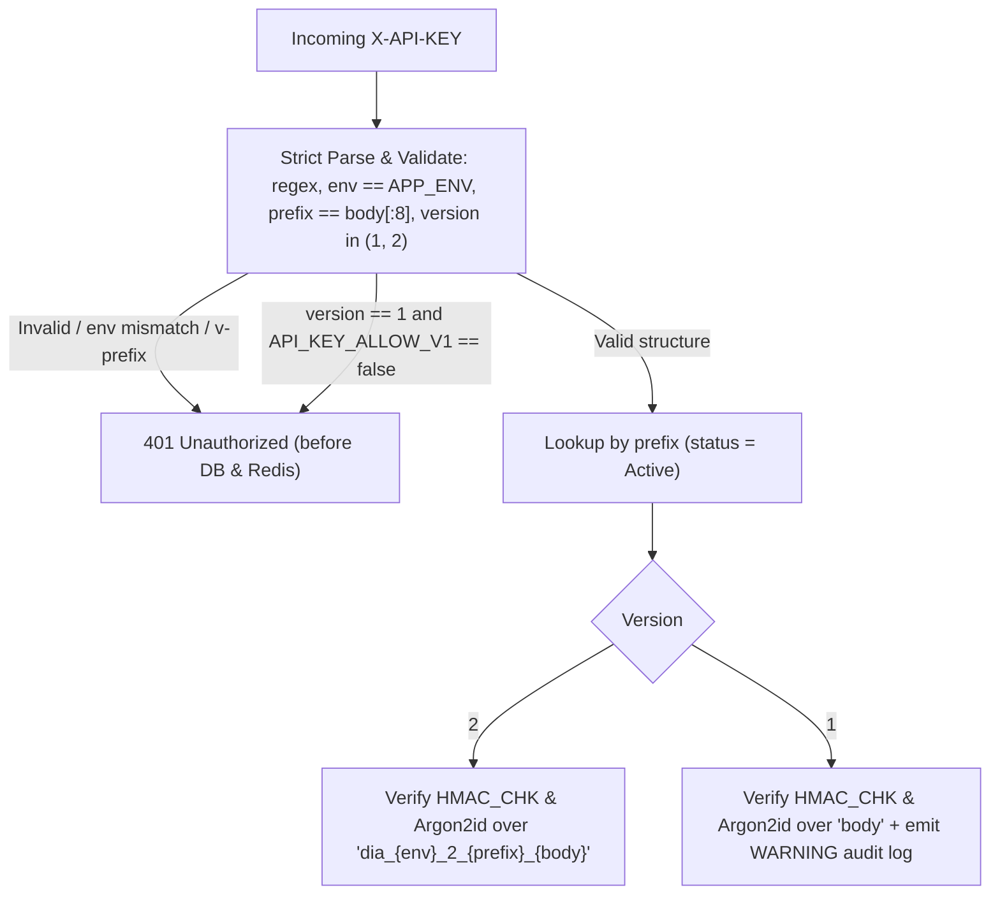

# Authentication

## Mechanism

The API uses an API key sent in the HTTP header:

```http
X-API-KEY: dia_<env>_<version>_<prefix>_<body>_<checksum>
```

Where:
- `env`: target environment (`dev`, `staging`, `sandbox`, `prod`) — must strictly match `APP_ENV`.
- `version`: integer key format version without `v` prefix (`1` for legacy keys during migration, `2` for canonical cryptographically bound keys).
- `prefix`: 8-character Base32 public lookup prefix (`body[:8]`).
- `body`: Base32-encoded 256-bit random secret (no padding).
- `checksum`: 4-character Base32 HMAC-SHA256 tag (`API_KEY_PEPPER_CHK`).

The FastAPI security scheme is defined in `api/auth.py` through `APIKeyHeader(name="X-API-KEY", auto_error=False)`.

## Key Format Versions & Cryptographic Binding (Security Initiative #151 / S8 / D5)

### Version `2` (Canonical Default)
All newly generated keys default to `API_KEY_VERSION=2`:
- Signing payload: `dia_{env}_2_{prefix}_{body}`
- Checksum: `HMAC-SHA256(API_KEY_PEPPER_CHK, signing_payload)[:4]` (Base32)
- Stored hash: `Argon2id(HMAC-SHA256(API_KEY_PEPPER_HASH, signing_payload))`

Binding `env`, `version`, `prefix`, and `body` into both the checksum and the stored Argon2id hash prevents metadata malleability and cross-version downgrade attacks (`1` $\leftrightarrow$ `2`).

### Version `1` (Legacy Transition Window)
Existing `v1` keys (`dia_<env>_1_<prefix>_<body>_<checksum>`) compute their checksum and Argon2id pre-hash MAC over `body` alone. During the 20-day rotation window:
- `API_KEY_ALLOW_V1=true` (default) preserves backward compatibility for legitimate `v1` keys without disrupting existing integrations.
- Strict structural validation is enforced immediately on `v1` keys as well: `env` must match `APP_ENV`, `version` must be `"1"` (without `v`), and `prefix` must match `body[:8]`. Any mutation is rejected with `401 Unauthorized`.
- Every successful `v1` authentication emits a `WARNING` log containing only `api_key_id`, `prefix`, and `organization_id` (never the secret) to track remaining legacy consumers.



## Configuration & Rotation Procedure

| Variable | Default | Description |
|---|---:|---|
| `APP_ENV` | `prod` | Runtime environment enforced against key `<env>` |
| `API_KEY_VERSION` | `2` | Version used when issuing new API keys |
| `API_KEY_ALLOW_V1` | `true` | Allows legacy `v1` keys during the 20-day migration window |

### Zero-Downtime Rotation (`v1` $\rightarrow$ `v2`)
1. Issue a new `v2` key for each organization via `POST /api/v1/admin/organizations/{organization_id}/api-keys`. Both `v1` and `v2` keys remain active concurrently; rate-limit quotas remain scoped per internal `api_key.id` UUID.
2. Notify partners and monitor `WARNING` logs for remaining `v1` usage.
3. After the 20-day migration window, revoke/delete legacy `v1` keys and set `API_KEY_ALLOW_V1=false` to reject any residual `v1` key globally.

## Behavior

1. Read key from `X-API-KEY`.
2. Validate structure, environment, version, and prefix in `ApiKeyHelper` (before DB lookup or Redis quota checks).
3. Resolve active key in DB (`ApiKeyService`) and verify checksum + Argon2id hash.
4. Verify linked organization.
5. Inject organization in `request.state.organization`.

If key is missing, invalid, mutated, or not linked:

- `401 Unauthorized`.

## Admin checks

Admin routes require `is_platform_admin`:

- key must be valid,
- organization must have role `PlatformAdmin`.

Otherwise:

- `403 Forbidden` (authenticated but not enough privileges).

## Related endpoints

- **Most business routes** require `X-API-KEY`.
- Some health routes may stay public depending on router setup.

See [Routes](./ROUTES.md) for endpoint-by-endpoint details.
