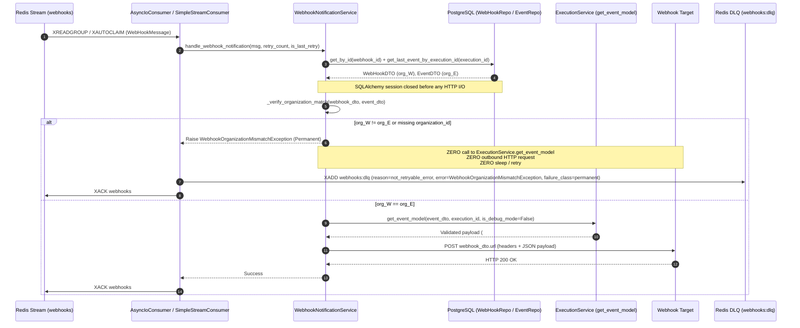

# Security Architecture: Webhook Organization Isolation & Delivery Policy

**Initiative**: #151 - Security Hardening
**Tracking Plan**: S9 | **Priority**: P1
**Associated Design Decision**: D4
**GitHub Reference**: `Closes #160`

---

## 1. Executive Summary

This document describes the defense-in-depth controls protecting Document IA against **cross-tenant webhook data exfiltration** (OWASP A01:2021 — Broken Access Control) during asynchronous workflow result delivery and administrative webhook management.

Specifically, it documents:
- Strict **organization matching** (`webhook_dto.organization_id == event_dto.organization_id`) enforced before payload construction (`ExecutionService.get_event_model`) and before any outbound HTTP request.
- **Immediate permanent refusal** without HTTP retries or Redis requeue, routed directly to the Dead-Letter Queue (DLQ) with non-sensitive diagnostics.
- **Organization-scoped administrative deletion** on `DELETE /api/v1/admin/organizations/{organization_id}/webhooks/{webhook_id}`.
- The **webhook destination network policy** (Decision D4), preserving legitimate internal/partner destinations configured by `PlatformAdmin`.

---

## 2. Threat Model & Why Event Self-Consistency (#140) Is Not Enough

### 2.1 Gap Addressed by S9 (#160)
Prior to S9, [`decode_event_dto`](../../document-ia-infra/src/document_ia_infra/data/event/schema/mappers/event_mapper.py#L30-L36) (#140) guaranteed that an `EventDTO` was internally consistent (envelope `organization_id` matching the inner JSON `event.organization_id`).

However, [`WebhookNotificationService`](../src/document_ia_api/infra/webhook_notification_service.py) fetches the webhook and the execution's latest event independently from PostgreSQL using a Redis Stream [`WebHookMessage(webhook_id, workflow_execution_id)`](../../document-ia-infra/src/document_ia_infra/redis/model/webhook_message.py):
- A valid `EventDTO` belonging to **Organization A** paired with a valid `WebHookDTO` belonging to **Organization B** (due to a corrupted message, stale reference, or Redis stream tampering) would pass #140 without error and exfiltrate Organization A's extracted document data to Organization B's endpoint.

### 2.2 Threat Matrix

| Threat Vector | OWASP Ref | Vulnerability Mechanism | Implemented Defense |
| :--- | :--- | :--- | :--- |
| **Cross-Tenant Webhook Exfiltration** | A01:2021 | `WebHookMessage` pairs `webhook_id` (Org B) with `workflow_execution_id` (Org A). | `_verify_organization_match` enforces non-empty strict equality of `organization_id` in both `handle_webhook_notification` and `_call_webhook_notification` **before** `get_event_model` and `client.post`. |
| **Retry Amplification on Security Violation** | A04:2021 | Retrying or requeueing a cross-tenant mismatch wastes worker/API capacity and delays alerting. | `WebhookOrganizationMismatchException` inherits from `SecurityException` and is classified `"permanent"` in `failure_classification.py` (0 HTTP retries, 0 Redis requeue, immediate DLQ + `XACK`). |
| **Sensitive Data Leakage in Logs / DLQ** | A09:2021 | Logging exception messages, URLs with tokens, headers, or document payloads during refusal. | Logs emit only `webhook_id` and `execution_id` (`ERROR` level); DLQ stores `error="WebhookOrganizationMismatchException"` and `failure_class="permanent"` without organization UUIDs or document content. |
| **Cross-Tenant Admin Deletion** | A01:2021 | `DELETE /organizations/{org_id}/webhooks/{webhook_id}` ignored `org_id` in SQL `DELETE`. | `WebHookRepository.delete` and `WebHookService.delete` scope deletion to `(webhook_id, organization_id)`, returning `404` on mismatch. |

---

## 3. Delivery & Isolation Sequence

---

## 4. Error Classification & DLQ Behavior

1. **Exception Hierarchy**: [`WebhookOrganizationMismatchException`](../../document-ia-infra/src/document_ia_infra/exception/security_exception.py) subclasses `SecurityException`.
2. **Failure Classification**: [`classify_failure`](../../document-ia-infra/src/document_ia_infra/redis/failure_classification.py) maps any `SecurityException` to `"permanent"`.
3. **Consumer Policies**:
   - **`AsyncIoConsumer` (`WorkerErrorPolicy`)**: Does not requeue (`WebhookOrganizationMismatchException` is not a `RetryableException`). Immediately retains the entry in `<stream>:dlq` with `reason="not_retryable_error"`, `error="WebhookOrganizationMismatchException"`, `failure_class="permanent"`, and acknowledges (`XACK`) the main stream entry.
   - **`SimpleStreamConsumer` (`WebhookErrorPolicy`)**: Catches `SecurityException` on the first attempt without backoff sleep and calls `retain("WebhookOrganizationMismatchException")`.
   - **PEL Recovery (`XAUTOCLAIM`)**: Reclaimed messages go through the exact same `handle_webhook_notification` path and are permanently rejected to DLQ without outbound HTTP traffic.

---

## 5. Webhook Destination Policy (Decision D4)

Unlike `file_url` (which is supplied by unauthenticated/end-user API callers and is strictly confined by [`SafeAsyncHTTPTransport`](../../document-ia-infra/src/document_ia_infra/core/network/safe_transport.py)), webhook registrations are **exclusively managed by `PlatformAdmin` operators** via [`admin/webhook.py`](../src/document_ia_api/api/routes/v1/admin/webhook.py).

Per **Decision D4** (Issue #160):
- **No additional IP/CIDR blocklist** is applied to outbound webhook HTTP requests at this stage, ensuring legitimate internal or partner network destinations remain operational without breaking changes.
- Outbound webhook destination governance remains an administrative responsibility enforced at webhook registration time by `PlatformAdmin`.

### 5.1 Open Items under Decision D4 (#151)

The following items under Decision **D4** (Initiative #151) remain open outside the scope of #160:
- **#161 (T1)**: 2D-Doc cryptographic trust store and unavailability states.
- **#162 (T2)**: Barcode state exposure and signed-field reconciliation (separating extraction, classification, barcode presence, and authenticity proof).
- **Future webhook destination network governance**: Should webhook registration ever be opened beyond the `PlatformAdmin` role, per-environment destination allowlists or DNS/IP filtering will need to be evaluated and enforced.

---

## 6. Verification Matrix

| Test Suite | Scope Covered |
| :--- | :--- |
| [`test_webhook_notification_service.py`](../tests/document_ia_api/unit/test_webhook_notification_service.py) | Organization mismatch in `handle_webhook_notification` and `_call_webhook_notification`, zero `get_event_model` / `post` calls, zero `asyncio.sleep`, non-sensitive logs, missing `organization_id`, valid same-org delivery unchanged. |
| [`test_webhook_error_policy.py`](../tests/document_ia_api/unit/test_webhook_error_policy.py) | `WebhookErrorPolicy` immediate DLQ retention on `SecurityException` without retries. |
| [`test_webhook_consumer.py`](../tests/document_ia_api/integration/test_webhook_consumer.py) | End-to-end Redis Stream DLQ routing (`failure_class="permanent"`, `pending == 0`) on initial delivery and PEL `XAUTOCLAIM` recovery. |
| [`test_retention.py`](../../document-ia-infra/tests/document_ia_infra/redis/test_retention.py) | `classify_failure(WebhookOrganizationMismatchException()) == "permanent"`. |
| [`test_webhooks.py`](../tests/document_ia_api/api/test_webhooks.py) & [`test_webhook_repository.py`](../../document-ia-infra/tests/document_ia_infra/data/webhook/repository/test_webhook_repository.py) | Organization-scoped `DELETE` returning `404` on cross-organization deletion attempts. |
